# Class diagrams: UML profile for REST API

These partial views model the current API, following the Chapter 6 slide 32 example and the supplied [Tutor Matcher example](https://github.com/Azther0z/tutor-matcher/blob/docs/OPS-0-add-rest-api-diagrams/docs/api-diagram.md). They describe the implementation; they do not rename endpoints or claim extra-credit eligibility.

| Notation             | Meaning                                                                          |
| -------------------- | -------------------------------------------------------------------------------- |
| `<<Application>>`    | One Dobby API, repeated in each view; add `/api/v1` once.                        |
| `<<Resource>>`       | Addressable URI with only its implemented HTTP methods.                          |
| `«Path»`             | URI fragment on a connection, appended to its parent. It is not a payload class. |
| `<<Representation>>` | Request or response JSON, linked by `«use»` dependencies.                        |

For example, `/api/v1` + `/bookings` + `/{bookingId}` reaches a booking member. Express spells the same parameter `:bookingId`. A method suffix is its success status. `QueryParam`/`QueryParams` are diagram labels; query filters do not form resource identity. There is no standalone `/provider` or `/admin` operation.

Representations use OpenAPI schema names. Wrapper fields such as `data : Booking` refer to that schema in the [committed contract](contracts/openapi.json); this is not a database class diagram. Nested fields, enum alternatives, required/optional rules and all error responses remain in OpenAPI. No raw credentials or tokens are included. `/api-docs` is Swagger UI outside this API profile.

All 34 OpenAPI operations are covered, including health (33 business operations). Permission explanations accompany each view. See [use cases](use-case-diagrams.md) and [sequences](sequence-diagrams.md).

## Views

- [Account registration](#account-registration)
- [Sessions and health](#sessions-and-health)
- [Public provider directory](#public-provider-directory)
- [Public vehicle discovery](#public-vehicle-discovery)
- [Representative profile and applications](#representative-profile-and-applications)
- [Administrator application review](#administrator-application-review)
- [Administrator provider lifecycle](#administrator-provider-lifecycle)
- [Representative vehicle collection and detail](#representative-vehicle-collection-and-detail)
- [Representative vehicle controls](#representative-vehicle-controls)
- [Customer and administrator bookings](#customer-and-administrator-bookings)
- [Representative booking reads](#representative-booking-reads)

## Account registration

Public signup creates a customer or a provider representative plus its initial pending application. Both return an initial session.


[Mermaid source](diagrams/rest-registration.mmd) · [Full-size SVG](diagrams/rest-registration.svg)

Implementation: [routes/auth.js](../routes/auth.js), [docs/contracts/openapi.json](../docs/contracts/openapi.json).

## Sessions and health

Login and health are public. Current-account and logout require a valid session; logout also permits a suspended provider. Health reports process status, not database readiness.


[Mermaid source](diagrams/rest-sessions.mmd) · [Full-size SVG](diagrams/rest-sessions.svg)

Implementation: [routes/auth.js](../routes/auth.js), [docs/contracts/openapi.json](../docs/contracts/openapi.json).

## Public provider directory

Public approved business directory. Returned fields exclude documents, contact email and application history.

Query parameters (`filters` is a diagram abbreviation, not a query key):

- `GET /providers`: `page`, `limit`.


[Mermaid source](diagrams/rest-public-providers.mmd) · [Full-size SVG](diagrams/rest-public-providers.svg)

Implementation: [routes/providers.js](../routes/providers.js), [docs/contracts/openapi.json](../docs/contracts/openapi.json).

## Public vehicle discovery

Public active listings require an approved provider/profile. Date-filtered lists additionally check offering windows and overlapping bookings; detail does not take a date query or reserve the car.

Query parameters (`filters` is a diagram abbreviation, not a query key):

- `GET /vehicles`: `page`, `limit`, `providerId`, `brand`, `model`, `transmissionType`, `fuelType`, `minSeats`, `minRatePerDaySatang`, `maxRatePerDaySatang`, `startDate`, `dueDate`, `sort`.


[Mermaid source](diagrams/rest-public-vehicles.mmd) · [Full-size SVG](diagrams/rest-public-vehicles.svg)

Implementation: [routes/vehicles.js](../routes/vehicles.js), [docs/contracts/openapi.json](../docs/contracts/openapi.json).

## Representative profile and applications

Provider role, scoped to the actor’s business. Pending/rejected representatives may use these routes; suspended representatives are denied. New submissions never mutate an older profile version.

Query parameters (`filters` is a diagram abbreviation, not a query key):

- `GET /provider/applications`: `page`, `limit`.


[Mermaid source](diagrams/rest-provider-applications.mmd) · [Full-size SVG](diagrams/rest-provider-applications.svg)

Implementation: [routes/provider.js](../routes/provider.js), [docs/contracts/openapi.json](../docs/contracts/openapi.json).

## Administrator application review

Administrator only. A pending application can be approved or rejected once. Rejection requires a reason; approval never clears suspension.

Query parameters (`filters` is a diagram abbreviation, not a query key):

- `GET /admin/applications`: `page`, `limit`, `status`, `providerId`.


[Mermaid source](diagrams/rest-admin-applications.mmd) · [Full-size SVG](diagrams/rest-admin-applications.svg)

Implementation: [routes/admin.js](../routes/admin.js), [docs/contracts/openapi.json](../docs/contracts/openapi.json).

## Administrator provider lifecycle

Administrator only. Suspension returns the provider plus the actual cancellation count. Reactivation requires an approved profile and never restores cancelled bookings.

Query parameters (`filters` is a diagram abbreviation, not a query key):

- `GET /admin/providers`: `page`, `limit`, `status`.


[Mermaid source](diagrams/rest-admin-providers.mmd) · [Full-size SVG](diagrams/rest-admin-providers.svg)

Implementation: [routes/admin.js](../routes/admin.js), [docs/contracts/openapi.json](../docs/contracts/openapi.json).

## Representative vehicle collection and detail

Approved representative only, scoped to their provider. Creation accepts specifications; detail PATCH changes only branch/rate. No vehicle deletion endpoint exists.

Query parameters (`filters` is a diagram abbreviation, not a query key):

- `GET /provider/vehicles`: `page`, `limit`, `isActive`.


[Mermaid source](diagrams/rest-provider-vehicles.mmd) · [Full-size SVG](diagrams/rest-provider-vehicles.svg)

Implementation: [routes/provider.js](../routes/provider.js), [docs/contracts/openapi.json](../docs/contracts/openapi.json).

## Representative vehicle controls

Approved owner only. Availability changes must retain non-completed bookings. Deactivation blocks new bookings and retains existing records. Full path labels repeat the member URI to keep this partial view small.


[Mermaid source](diagrams/rest-vehicle-controls.mmd) · [Full-size SVG](diagrams/rest-vehicle-controls.svg)

Implementation: [routes/provider.js](../routes/provider.js), [docs/contracts/openapi.json](../docs/contracts/openapi.json).

## Customer and administrator bookings

Customers may create and manage their own bookings. Administrators may read, date-edit and cancel across providers, but cannot create bookings. userId/providerId filters are admin-only. DELETE means cancellation and returns JSON with 200.

Query parameters (`filters` is a diagram abbreviation, not a query key):

- `GET /bookings`: `page`, `limit`, `status`, `providerId`, `userId`.


[Mermaid source](diagrams/rest-bookings.mmd) · [Full-size SVG](diagrams/rest-bookings.svg)

Implementation: [routes/bookings.js](../routes/bookings.js), [docs/contracts/openapi.json](../docs/contracts/openapi.json).

## Representative booking reads

Approved representative only. Both operations are read-only and scoped to the actor’s provider. Responses include current customer contact and fixed booked vehicle details.

Query parameters (`filters` is a diagram abbreviation, not a query key):

- `GET /provider/bookings`: `page`, `limit`, `status`, `vehicleId`.


[Mermaid source](diagrams/rest-provider-bookings.mmd) · [Full-size SVG](diagrams/rest-provider-bookings.svg)

Implementation: [routes/provider.js](../routes/provider.js), [docs/contracts/openapi.json](../docs/contracts/openapi.json).

## Editing and exports

Edit the matching `.mmd`, regenerate its `.svg`, and keep both together. Shared [Mermaid settings](diagrams/mermaid-config.json) use the default theme, Arial and native SVG text on white. Each SVG renders directly without Mermaid support. Keep `xml:space="preserve"` on the SVG root.

Rendered with Mermaid 11.17.2 through Mermaid CLI 11.12.0. Renderer tooling is separate from application dependencies. Example export command:

```sh
mmdc -i docs/diagrams/rest-registration.mmd \
  -o docs/diagrams/rest-registration.svg \
  -c docs/diagrams/mermaid-config.json -b white
```
