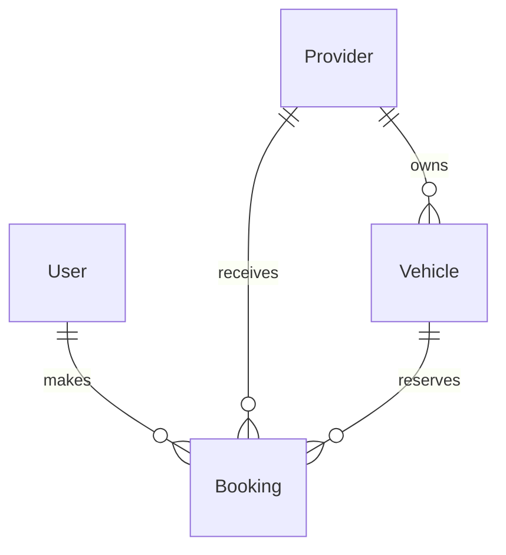

# Technical design

Use [OpenAPI](contracts/openapi.json) for endpoint names, inputs and response shapes. This file covers data, shared API rules and service functions. Update affected definitions together before changing the implementation.

The branch implements authentication, provider review/lifecycle, vehicles and bookings, plus setup/demo tooling. Review and merge status are tracked in the implementation plan and PRs. See README for verification limits.

## Contents

- [Application structure](#application-structure)
- [HTTP policies](#http-policies)
- [Persistence](#persistence)
- [Service interfaces and transactions](#service-interfaces-and-transactions)

## Application structure

Use Node 24/npm/CommonJS, Express 5, Mongoose 9 and Atlas. Installed packages include dotenv, bcryptjs, jsonwebtoken, CORS, cookie-parser, Helmet, express-rate-limit, swagger-ui-express and Newman. Package versions are pinned in the manifest and lockfile.

- `server.js` loads the environment, initializes Express, and starts `connectDB()` without awaiting it. It mounts middleware/routes and defines `app.listen()`. See [README](../README.md) for runtime verification limits.
- Use config/routes/controllers/services/models/middleware/utils, plus scripts/tests/postman. See [coding practices](../AGENTS.md#coding-practices) for responsibilities.

Routes import controller functions by name and declare paths, authentication and roles. Controllers call request validators directly and use local input/filter/ID variables, without validation middleware or derived request properties (D-48). Shared body/query rejection functions live in validators/request.js. Authentication/roles remain middleware; provider controllers check eligibility before request validation (D-52), with write services rechecking inside their transactions. Express handles uncaught parser errors by default (D-49).

The configured local port defaults to 5003. Health is at `/api/v1/health`; Swagger UI at `/api-docs` serves committed JSON. CORS uses default middleware options. `cookie-parser` parses cookies; it does not implement cookie authentication. Auth routes use Bearer authentication with revocable sessions.

## Provider terminology transition (D-51)

The representative User uses role `provider`; the rental business stays in Provider. The signup route is `POST /auth/register-provider`; representative routes use `/provider/...`. Public `/providers` and admin `/admin/providers` remain plural collection routes. Provider IDs, representative IDs, booking snapshots, collections and indexes are unchanged.

This is an API/role rename with no legacy aliases. Update clients and Postman to the new paths and role. Existing User records using the old role need an explicitly authorized database update before the new API is used with those accounts. In the selected database, the narrowly scoped update is:

```js
db.users.updateMany({ role: 'company' }, { $set: { role: 'provider' } });
```

No migration runs at startup or as part of this source change. Keep providerId and representativeId links intact. Authentication reads the current role from User; JWT claims do not contain the role, so role migration alone does not require reissuing tokens.

## HTTP policies

### Input and responses

Input policy: server.js parses JSON once with app.use(express.json()), using Express's default 100 KB limit (D-46). There is no custom parser-error handler (D-49). Reject unknown body/query fields, wrong scalar/array/operator types and malformed IDs. IDs are 24 hex characters; dates must be real YYYY-MM-DD calendar dates. Normalize only the specified strings; do not turn objects/arrays into strings. `Satang` fields are safe integers.

Success: `{success:true,data:...}`. Lists also return count (rows on this page) and pagination `{page,limit,total,pages}`.

- Default page 1, limit 25; maximum limit 100.
- `pages = ceil(total/limit)`, or zero when there are no matches.
- A page beyond the end returns empty data with the correct filtered total.
- Default sort: createdAt descending, then id descending.
- Application history: version descending. Admin queue: submittedAt ascending, then id ascending.

Application errors: `{success:false,message}`. Framework parser errors are the HTML exception described below. Use HTTP status plus a safe reason in the message; do not return stacks, DB diagnostics, connection strings, raw queries or tokens. Clients cannot choose arbitrary projections or populate fields.

### Validation order

For protected requests:

```text
JSON parsing → authentication → role → provider state → input validation → scoped lookup
→ record state/cutoff → proposed dates/window/eligibility → cap → overlap → write
```

Repeat transaction-sensitive checks after acquiring guards. A unique-index error at write time still needs a domain error.

Malformed JSON returns 400 and oversized JSON returns 413 before route authentication, including on unknown paths. These use Express default HTML error responses, not the application JSON envelope. Express controls diagnostic detail according to its environment setting. Valid JSON follows route authentication/permission checks, then controller validation in the same order as before.

| Status | Reason                                                                                                   |
| ------ | -------------------------------------------------------------------------------------------------------- |
| 400    | Invalid input or request shape                                                                           |
| 401    | Missing, invalid, expired, or revoked session; generic invalid credentials                               |
| 403    | Authenticated actor lacks permission or provider is not eligible                                         |
| 404    | Missing or hidden resource, including another owner's private resource                                   |
| 409    | Duplicate, invalid state, booking limit, unavailable vehicle, overlap, cutoff, window, or write conflict |
| 413    | JSON body exceeds the parser limit; Express default HTML response                                        |
| 429    | Request limit exceeded                                                                                   |
| 500    | Unexpected server failure                                                                                |

Return 404 for another owner's private record, or a public detail request for an inactive vehicle, suspended provider or other hidden record. Unapproved provider management returns 403. A customer booking an ineligible listing gets 409 without private application details.

Health/Swagger are public. Authentication is Bearer only. Wrong login credentials get one generic 401 message; valid suspended accounts get 403. Logout requires a valid session but bypasses the provider-state check and returns no provider data. Reusing its token then returns 401.

### Access and discovery

Scope customer bookings by actor userId. Admin reads are global; providers read only own-vehicle bookings across all statuses. Provider responses include current customer name/email/telephone and booked details. A provider filter for another provider's vehicle returns 404. Customer lists cannot accept userId/providerId filters; admin lists may filter provider/user/status.

Provider signup creates User, Provider and the first application in one transaction. Pending/rejected providers can read their application history. Suspended providers cannot use protected reads/writes or submit profiles; logout is the exception.

Public discovery returns approved providers and active vehicles, with no private bookings, applications, customer information or document links.

- Without rental dates, hide expired availableUntil but keep future availableFrom listings.
- With rental dates, require both dates and filter by the full offering period and overlap rules.
- Search does not reserve a vehicle; booking creation checks again.

### Defaults and normalization

Current A00 mounts one IP rate limiter at 1000 requests per 10 minutes before health and Swagger, so it applies to those routes too. Authentication routes use this same global limit; there is no separate login/signup limiter (D-47). Helmet is mounted. Never log password/document payloads.

Trim registration numbers without changing case. Trim/uppercase VINs; uniqueness includes inactive vehicles. Phone numbers are strings. Document links must be valid HTTPS URLs and visible only to owner/admin. Do not fetch, preview, classify or host them. The submitter controls external sharing permissions; we make no legal authenticity checks.

## Persistence

All collections use timestamps and ObjectId references. A owns User/Provider/ProviderApplication/AuthSession; B owns Vehicle/Booking.

### Values and limits

- Roles: user/provider/admin; user means customer. Signup sets the role; admins are seeded.
- Dates: validated YYYY-MM-DD strings, Asia/Bangkok, inclusive, 1–30 days. Duration is UTC calendar ordinal(dueDate) - ordinal(startDate) + 1. Event timestamps are Date instants.
- Money: integer satang, currency THB; rate 1..1,000,000,000 and total 1..30,000,000,000.
- Trim strings. Maximum lengths: name 120, legalName 200, address 500, branch name/address 120/500, email 254, model 120, optional brand 80, document URL 2048.
- Other lengths: telephone 3..30, registration number 1..50, VIN 6..40, reasons/notes 1..1000. No legal ID checksum checks.
- Password: 8–72 UTF-8 bytes. OpenAPI permits non-empty strings because its character-length constraint cannot express the byte limit; server validation enforces the byte rule. Optional model year: integer 1900..2100. Seats: integer 1..20.
- Transmission: automatic/manual. Fuel: petrol/diesel/hybrid/electric/other.

### User — A

`name`, `telephone`, `email` (normalized unique login), `passwordHash` (select false), `role`, `providerId` (provider only, null otherwise), `bookingRevision` (integer, default 0).

Login email is immutable. There is no identity-change, account-delete or password-recovery API. Keep User.providerId and Provider.representativeId consistent after atomic provider signup. `bookingRevision` is a guard, not a booking count. Hash with bcryptjs, 10 rounds; see the [save-hook rules](../AGENTS.md#coding-practices).

Indexes: unique `{email:1}` named `uq_user_email`; partial unique `{providerId:1}` with providerId type ObjectId named `uq_user_provider`. Ensure role/provider consistency in signup validation; never unique-index nullable providerId without a filter.

### Provider — A

`representativeId` (User), `businessRegistrationNumber` (trimmed immutable), `status` enum pending/rejected/approved/suspended, `approvedApplicationId` nullable, `latestApplicationId`, `applicationSequence` integer, `revision` integer default 0, `suspensionReason` nullable, `suspendedAt` nullable, `suspendedBy` nullable User, `reactivationNote` nullable, `reactivatedAt` nullable, `reactivatedBy` nullable User.

Keep operational status separate from application review:

- First submission → pending; rejection without an approved profile → rejected; resubmission → pending.
- Approval → approved unless already suspended.
- A pending/rejected revision leaves an approved provider's status unchanged.
- Admin may finish a review during suspension, but approval cannot reactivate the provider.
- Reactivation needs suspended state and an approved profile; cancelled bookings and revoked sessions stay unchanged.

Public name/address/telephone come from the approved profile's legalName/registeredAddress/telephone. Lifecycle fields keep the latest suspension/reactivation only; full event history remains an [open decision](decisions.md#open-decisions).

Indexes: unique registration number (`uq_provider_registration`), unique representativeId (`uq_provider_representative`), `{status:1,createdAt:-1,_id:-1}`.

### ProviderApplication — A

`providerId`, `version` positive sequence, `businessRegistrationNumber` immutable copy, `profile` embedded `{legalName,registeredAddress,telephone,contactEmail,documentUrl}`, `status` pending/approved/rejected, `rejectionReason` nullable, `reviewedBy` nullable, `submittedAt`, `reviewedAt` nullable.

Read the approved profile through approvedApplicationId. Submitted fields are fixed; review changes status/reviewer/reason/time only. Review requires pending status and either approval or rejection with a nonempty reason; repeating it returns 409 with an invalid-state reason.

The server copies registration identity. Change provider contact email through a new profile version; it need not be unique. Allocate versions under the provider guard.

Indexes: unique `{providerId:1,version:1}` (`uq_application_version`); unique `{providerId:1}` partial `{status:'pending'}` (`uq_application_pending`); `{status:1,submittedAt:1,_id:1}`. Sequence allocation and new submission use the provider transaction guard.

### AuthSession — A

`sid` random UUID/string, `userId`, `expiresAt`, `revokedAt` nullable.

Protect verifies JWT signature, HS256 and expiry, then requires an existing user and matching unrevoked/unexpired session. Read current role/provider state from DB. Claims: sub=userId, sid, iat, exp. Sessions last 24 hours, with multiple logins allowed. Store no raw JWT. Issuer/audience are not set; if added, signing and verification must agree.

Indexes: unique sid (`uq_session_sid`), optional expiresAt TTL 0, `{userId:1,revokedAt:1}`. Enforce expiry in middleware regardless of TTL cleanup. Logout updates revokedAt and does not require approved provider state.

### Vehicle — B

`providerId` immutable; `vin` uppercase immutable globally unique; optional brand/modelYear; model/transmissionType/fuelType/seatingCapacity immutable; `pickupBranch` embedded `{name,address}`; `ratePerDaySatang`; `availableFrom`; `availableUntil` nullable default null; `isActive` default true; `revision` default 0.

Descriptive PATCH accepts pickupBranch and/or ratePerDaySatang. Window and activation are separate operations. Keep fixed identity/specification fields unchanged.

Require availableFrom <= availableUntil when an end exists. Do not require an old window start to be >= today on later edits; the booking start must be >= today. Window edits must retain every upcoming/ongoing confirmed booking. Branch changes leave booked snapshots unchanged.

Indexes: global unique `{vin:1}` (`uq_vehicle_vin`); `{providerId:1,isActive:1,createdAt:-1,_id:-1}`; additional discovery indexes only after measurement. No hard-delete endpoint.

### Booking — B

Immutable refs `userId`, `providerId`, `vehicleId`; `startDate`, `dueDate`; `state` confirmed/cancelled; `vehicleSnapshot` embedded VIN/optional brand/year/model/transmission/fuel/seats/pickupBranch; `ratePerDaySatang` immutable; `rentalDays`, `totalPriceSatang`, currency THB; `cancelledAt`, `cancelledBy`, `cancellationReason` nullable. Reasons customer_cancelled/admin_cancelled/provider_suspended. cancelledBy is the triggering user/admin; suspension uses suspending admin ID.

Create the vehicle/branch/rate snapshot once. Date edits update dates/days/total only. Read current customer name/email/telephone for authorized responses; snapshots never contain passwords or document URLs.

Derive status:

- cancelled when state is cancelled.
- upcoming when startDate > today.
- ongoing when startDate <= today <= dueDate.
- completed when dueDate < today.

Count confirmed records with dueDate >= today for the owner. Same-vehicle overlap is `startDate <= request.dueDate && dueDate >= request.startDate`, using confirmed records and excluding self on edit. Also assert matching providerId. Completion needs no midnight job or manual return; different vehicles can overlap for one customer.

Indexes: `{userId:1,state:1,dueDate:1}` for cap; `{vehicleId:1,state:1,startDate:1,dueDate:1}` for overlap; `{providerId:1,state:1,dueDate:1}` for suspension; `{userId:1,createdAt:-1,_id:-1}` and `{providerId:1,createdAt:-1,_id:-1}` for scoped history. No unique interval index is claimed; the transaction protocol supplies exclusion.

### Indexes and output

Create collections/indexes in explicit bootstrap/seed before mutation tests. Do not sync/drop indexes on normal startup against an unspecified DB. Test uniqueness and select:false behavior, not just field declarations.

Serialize _id as id; hide __v, revisions, passwordHash, sid and raw claims. Select populated fields explicitly. Public provider fields are id/name/address/telephone; application history is owner/admin only. Password hashes stay hidden even after login uses select('+passwordHash').

### B01 module interfaces

- `validators/vehicles.js`: `validateVehicleCreate(body)`, `validateVehicleUpdate(body)`, `validateAvailabilityUpdate(body)`, `validateActivationUpdate(body)` return allowlisted input matching OpenAPI. Creation permits an omitted end date; availability updates require both fields, with null for no end.
- `validators/bookings.js`: `validateBookingCreate(body)`, `validateBookingDatesUpdate(body)` validate request shape and calendar ranges. B03 checks the original booking cutoff before applying `validateRentalDates` to proposed dates, preserving the validation order above.
- `validators/fields.js` holds the existing scalar/object checks shared with auth; moving those checks does not change auth behavior. List/query validation is called directly by the B02/B03 controllers.
- `serializers/vehicles.js`: `serializeVehicle(vehicle)`, `serializeVehicleSnapshot(vehicle)`. `serializers/bookings.js`: `serializeBooking(booking, customer, today)` requires explicitly selected current customer contact and one captured Thailand date. These return DTOs, not HTTP envelopes, and never populate database references themselves.
- Vehicle and Booking enforce field constraints and fixed snapshots on document saves. Booking checks that dates, days and total agree; historical records remain valid. Later services own eligibility, permissions, state transitions and concurrency guards. Query writes must use allowlisted fields and enable update validation; multi-field booking edits use document saves so the consistency checks run.
- `npm run test:integration` runs both owners' suites. Auth/provider-review tests use `TEST_MONGO_URI` with `dobby_test_a`; rental models use `TEST_MONGO_URI_B` with `dobby_test_b`. Each suite rejects a different database name before connecting and deletes only its synthetic fixture IDs.



Booking embeds the booked vehicle details and branch; its rate is stored separately. Those values remain fixed when the listing changes.

## Service interfaces and transactions

Use CommonJS named exports. Keep small, single-use feature logic in controllers (D-42); extract a service when reuse or complexity warrants it. Controllers serialize OpenAPI DTOs. Extracted I/O functions return promises and records, not Express responses. No private controller imports across modules.

### Context and shared helpers

Centralized API error abstractions are deferred until the codebase is mature enough to demonstrate their value (D-39). Return `{success:false,message}` with the HTTP status conveying the category (D-41). Services may throw ordinary `Error` objects with an HTTP `status`; controllers map those to responses directly in each catch block and return safe messages, without a sendError helper (D-50).

A provides `middleware/auth.js` with `protect`, `authorize(...roles)` and provider-state checks:

```js
req.actor = {
  userId: '24-hex ID',
  role: 'user', // user/provider/admin
  providerId: null, // provider: 24-hex ID
  sessionId: 'UUID',
};
```

Booking and vehicle services receive explicit actor arguments and an optional `now = new Date()` instead of context/clock objects. Reads capture one time per response; writes use the supplied operation time throughout retries. Services must recheck scope/provider state inside transactions. Admin service calls also check actor.role, even with route middleware. The controller or service implementing an operation owns its transaction boundary when it needs atomic writes. Every database operation in one transaction uses the same session, sequentially. No shared transaction wrapper is used.

#### B00 helper contracts

B's helpers use CommonJS named exports. They do not load the app or database. Invalid input throws an ordinary `Error` with `status: 400` and a safe message.

| Module           | Function                                       | Returns                                                                                            |
| ---------------- | ---------------------------------------------- | -------------------------------------------------------------------------------------------------- |
| `utils/dates.js` | `todayBangkok(now)`                            | Thailand `YYYY-MM-DD` for a supplied valid `Date`                                                  |
|                  | `validateDateOnly(value)`                      | Unchanged real date string, years 0001–9999; no whitespace or type coercion                        |
|                  | `inclusiveDays(startDate,dueDate)`             | Inclusive day count; rejects reversed dates                                                        |
|                  | `validateRentalDates(startDate,dueDate,today)` | Day count after checking start >= today and duration 1–30 days                                     |
|                  | `overlaps(aStart,aDue,bStart,bDue)`            | Whether valid ordered ranges share any day, including endpoints                                    |
|                  | `bookingStatus(booking,today)`                 | Derived cancelled/upcoming/ongoing/completed status from confirmed/cancelled state and valid dates |
| `utils/money.js` | `calculateTotal(ratePerDaySatang,rentalDays)`  | Integer satang total; integer rate 1–1,000,000,000 and days 1–30                                   |

Keep calendar calculations separate from new-rental validation: historical bookings still need a status, and offering periods may exceed 30 days. Later feature validators apply these helpers in the HTTP validation order; serializers return date strings, integer satang and derived status.

A's provider service can import B's bookingCancellation. Keep feature services independent to avoid circular imports; transaction and guard code stays with the feature that owns it.

### Service functions

IDs are normalized strings; list filters are parsed/validated. Services still enforce scope. Results are persistence records unless marked DTO/summary.

| Module / owner                       | Export                                                                                                                                              | Result                                                          |
| ------------------------------------ | --------------------------------------------------------------------------------------------------------------------------------------------------- | --------------------------------------------------------------- |
| controllers/auth.js / A              | registerCustomer(req, res), registerProvider(req, res), login(req, res)                                                                             | AuthResult HTTP response                                        |
| controllers/auth.js / A              | logout(req, res), getMe(req, res)                                                                                                                   | Ok / safe User HTTP response                                    |
| controllers/providers.js / A         | Own profile/history, submissions, admin reads and reviews (req, res)                                                                                | Safe HTTP responses; submission/review transactions remain here |
| controllers/providerLifecycle.js / A | suspendProvider(req,res), reactivateProvider(req,res)                                                                                               | Safe HTTP responses; lifecycle transactions remain here         |
| controllers/vehicles.js / B          | listOwnVehicles(req,res), getOwnVehicle(req,res)                                                                                                    | Scoped, serialized Vehicle/Page HTTP responses                  |
| controllers/bookings.js / B          | listBookings(req,res), getBooking(req,res), listProviderBookings(req,res), getProviderBooking(req,res)                                              | Scoped, serialized Booking/Page HTTP responses                  |
| services/vehicles.js / B             | listPublicProviders(filters), getPublicProvider(id), listPublicVehicles(filters,now), getPublicVehicle(id,now)                                      | Page/public record; no actor needed                             |
| services/vehicles.js / B             | createVehicle(input,actor,now), updateVehicle(id,input,actor,now), updateAvailability(id,input,actor,now), setVehicleActivation(id,input,actor,now) | Vehicle                                                         |
| services/bookings.js / B             | createBooking(input,actor,now), updateBookingDates(id,input,actor,now), cancelBooking(id,actor,now)                                                 | Booking; user/admin scope only                                  |

`Page<T> = {data:T[],count:number,pagination:{page,limit,total,pages}}`. Controllers add success:true without nesting Page inside data. Booking cancellation has a separate named transaction flow; create/date-edit share eligibility and cap/overlap checks. All booking writers retain provider → user → vehicle guards.

### Transaction-sensitive writes

B02/B03 use the A03 guard fields directly: increment Provider.revision, then sorted User.bookingRevision values, then sorted Vehicle.revision values. Feature services own their sessions and use snapshot/majority transactions with a 2500 ms driver retry budget. Each operation uses one Thailand date. Known uncommitted transient conflicts return 409; uncertain commit results remain safe 500 responses. Reads use allowlisted filters before pagination; discovery joins only approved profiles and excludes occupied vehicles before counting.

Use transactions for the multi-record writes identified below. Guard operations are implemented in the owning feature services and coordinated between A and B; A03a is the guard agreement and integration point, not a generic transaction framework. Acquire guards in this order: provider → sorted users → sorted vehicles. Each transaction concerns one provider; never acquire another provider after user locks. The User guard protects the booking cap across providers. Missing guard targets return scoped 404 responses, not placeholder records.

Counting inside a transaction alone can still allow competing inserts. All affected write paths need the specified guards, same-session checks and writes, and rechecks after acquiring guards.

### Booking writes — B

B03 records returned by booking services populate only `userId` with current name/email/telephone, after applying ownership scope. The booking serializer accepts that selected customer record and still returns a scalar userId. Writes clear the completed transaction session before response population. Date-edit request validation checks shape/calendar ordering; cutoff, duration, eligibility, cap and overlap run in the service in the documented order.

1. Identify fixed provider/user/vehicle references. Preliminary reads only identify targets; do not trust them for final validation.
2. Start the service-owned transaction, take guards in order, re-read records and check matching references, scope and provider/vehicle eligibility.
3. Check state/cutoff before proposed dates, then cap and overlap. Date PATCH needs both dates, new start >= today and the full rental inside the window. Count owner bookings excluding self on edit: fewer than three before creation, at most three after edit.
4. Creation snapshots current vehicle/branch/rate. Edits keep snapshots/rate and recalculate days/total. Cancellation retains the record and stamps actor/reason/time once. Commit before returning the response.

Customer cancellation and customer/admin date edits require today < old startDate. Admin may emergency-cancel ongoing rentals. A booking starting today is already ongoing; test that it cannot be customer-cancelled or date-edited.

DELETE means cancellation. Repeating an authorized cancellation returns 200 with no new effects. Cancelling a completed booking returns 409 with a completed-state reason. Cancelled records cannot be edited or restored; do not maintain negative cancellation counters.

### Suspension — A and B

B exports from services/bookingCancellation.js:

```js
cancelNonCompletedForProvider({ providerId, actorId, today, now, session });
// -> { cancelledBookingCount: number }
```

The caller must already hold the provider guard and passes its session to this helper. B queries confirmed provider bookings with dueDate >= today, applies sorted user and vehicle guards in that same session, and re-reads/updates the scoped set. Set state cancelled, reason provider_suspended, cancelledBy actorId and cancelledAt now. Return the actual modified count.

This helper does not start a transaction, change provider state, respond to HTTP or trigger external effects.

A's suspendProvider checks admin, owns the transaction, applies the approved-provider guard, sets suspended/reason/time and calls B with the same session. Return only after commit. If cancellation fails, roll back both changes. Leave completed/cancelled history unchanged.

Reactivation needs admin, suspended state, an approved profile and resolutionNote; restore eligibility only. Repeated lifecycle actions return 409 with an invalid-state reason. Booking/listing writes take the same provider guard, so they commit before suspension and are cancelled, or retry against suspended state. Test these races; do not cancel in a separate transaction.

### Application and vehicle writes

A locks Provider for version allocation, submission, review, suspension and reactivation. Submission increments applicationSequence and sets latestApplicationId. The partial unique index enforces one pending version. Review uses a pending-status compare-and-set, writes reviewer/reason/time and switches the approved pointer atomically without clearing suspension. Profile revisions cannot change login/registration identity.

B locks provider then vehicle for branch/rate/window/activation changes, rechecks approved ownership and applies the allowlist. Window edits retain confirmed upcoming/ongoing bookings; activation does not cancel them. Creation needs the provider guard and unique VIN index, with no vehicle guard before insertion. Booking and listing changes therefore use a consistent branch/rate/window state.

### A03 implementation boundary

The lifecycle controller owns suspend/reactivate transactions. The agreed cancellation helper operates on real booking/vehicle collections and User guards using the caller session. Its interface remains available for B integration; it does not supply B's booking or vehicle APIs. See [A03 integration checks](diagrams/a03-provider-lifecycle.md).

### B02 vehicle flow

```mermaid
sequenceDiagram
    actor Provider
    participant Route as Vehicle route
    participant Controller as Vehicle controller
    participant Service as Vehicle service
    participant DB as MongoDB
    Provider->>Route: Vehicle change request
    Route->>Controller: Authenticated approved provider request
    Controller->>Controller: Validate ID, body and query
    Controller->>Service: Allowlisted input, actor and optional time
    Service->>DB: Begin transaction; guard provider then vehicle
    Service->>DB: Recheck approval, ownership and retained bookings
    Service->>DB: Save and commit
    Service-->>Controller: Saved vehicle
    Controller-->>Provider: Safe vehicle response
```

### B03 booking flow

```mermaid
sequenceDiagram
    actor Customer
    participant Route as Booking route
    participant Controller as Booking controller
    participant Service as Booking service
    participant DB as MongoDB
    Customer->>Route: Vehicle and rental dates
    Route->>Controller: Authenticated customer request
    Controller->>Controller: Validate ID, body and query
    Controller->>Service: createBooking or updateBookingDates, input, actor, now
    Service->>DB: Guard provider, customer and vehicle in one transaction
    Service->>DB: Recheck eligibility, counted bookings and overlap
    Service->>DB: Save dates, snapshot and calculated total; commit
    Service-->>Controller: Booking with selected current customer contact
    Controller-->>Customer: Allowlisted booking response
```

Cancellation calls `cancelBooking(id, actor, now)` in its own service flow. It takes the same provider → user → vehicle guards, rechecks scoped ownership and the cancellation cutoff, and saves cancellation metadata in one transaction. Repeated cancellation returns the original record; vehicle activation and new-booking eligibility do not block cancellation.

### B04 provider access and suspension integration

Provider booking reads require current approved status, scope by provider before population, and return current selected customer contact with booked snapshots. A provider vehicle filter is checked for ownership before querying bookings. The A03 cancellation helper remains unchanged. HTTP race tests hold real booking guard writes until MongoDB reports contention, then verify suspension leaves no confirmed non-completed booking. Fault injection after actual cancellation writes verifies rollback of provider state, bookings and user/vehicle guard revisions.

### B05 setup and delivery

The combined Postman collection extends A05 with vehicle/booking folders and assertions for suspension cancellation and no restoration. Credentials and generated tokens stay in memory. Seed adds two approved-provider vehicles and a fixed synthetic historical booking; reseeding can replace only identified fixtures and refuses other dependent data. Reset defaults to A; `--owner=b` explicitly selects B and still requires the reset flag. Performance checks use a separate `TEST_PERF_MONGO_URI` naming `dobby_test_performance`, build the prescribed two-provider/ten-vehicle/thirty-history dataset and report every elapsed time. Local runs do not establish Atlas results.

### Course alignment for B

Vehicle and booking endpoints retain the course route/controller/model structure. Focused services own the transactions because booking caps, overlap and suspension span multiple records. Dobby adds fixed booking snapshots, integer-satang calculations, Thailand calendar rules, scoped output and real race checks to implement the agreed rental requirements.
