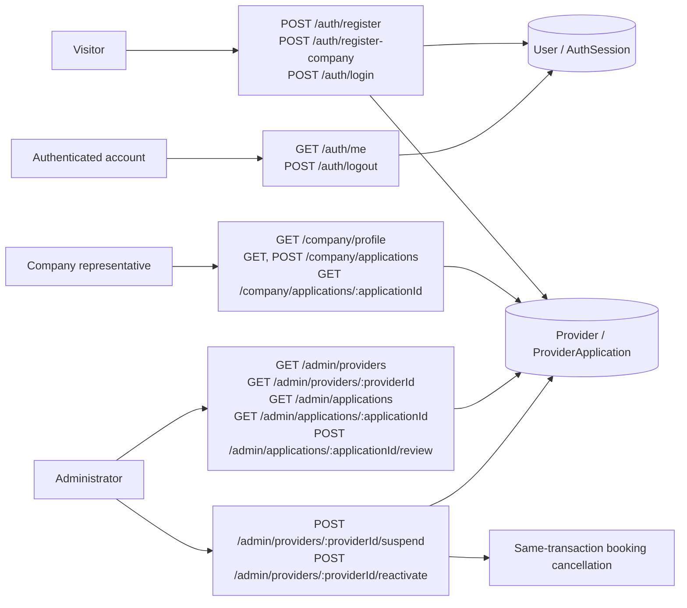

# A API map

The [OpenAPI JSON](../contracts/openapi.json) is the authoritative field/status contract. These are the implemented A operations, grouped by access. Route paths share `/api/v1`.

Company protected reads/writes require a current non-suspended provider. Pending/rejected companies can read history and submit revisions but cannot manage vehicles. Logout permits a suspended account. B owns the vehicle/booking endpoints and their remaining integration.

This is an engineering API map. The instructor's UML Profile for API notation remains unconfirmed under D-07.
