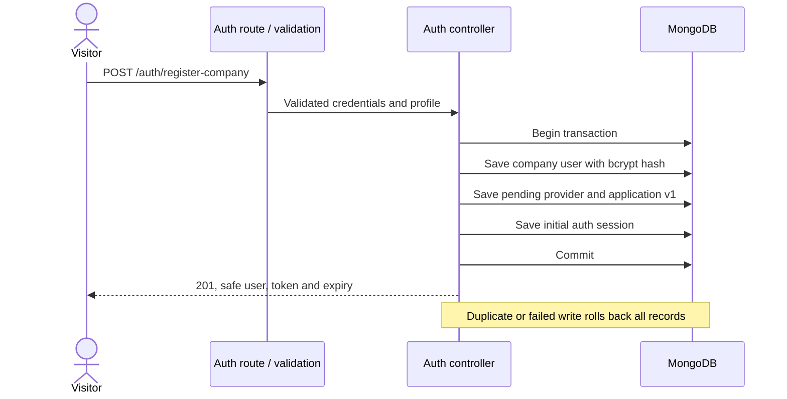
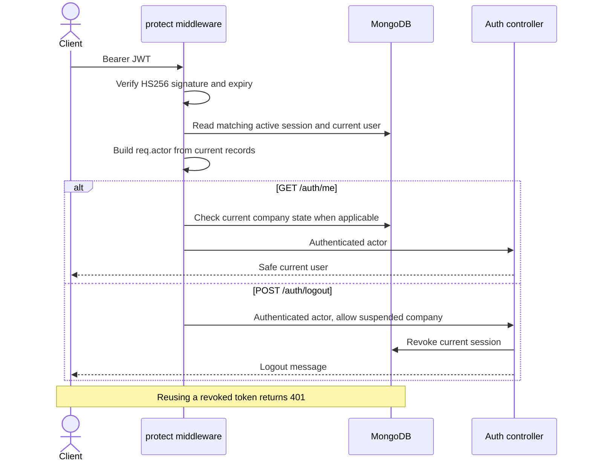

# A01 authentication

A01 covers FR-01, FR-02 and the initial signup portion of FR-10. Application reads/review belong to A02; suspension writes belong to A03. See [OpenAPI](../contracts/openapi.json) for fields and responses.

## Use cases

- A visitor registers a customer or a company representative and receives an initial session.
- An account holder logs in and receives another independent 24-hour session.
- An authenticated account holder reads their own account.
- An account holder logs out of the current session. Other sessions remain active.
- A suspended representative can log out but cannot log in or read protected company data.

## Company signup

## Protected requests and logout

## API responsibilities

Routes choose validation, authentication and permission checks. Auth controllers own persistence, company-signup transactions, and local error responses using the committed OpenAPI shapes. Models define fields, indexes and password hashing. The user serializer allowlists public account fields.

These diagrams describe the A01 implementation scope. They do not establish a live database test result or satisfy the unresolved course-specific UML Profile notation decision (D-07).

## Course alignment

The [assignment 9 backend](https://github.com/Azther0z/cp51/tree/d959a57b66f90592b27eaeb48d6acae71e245ae/2110503-sw_dev_prac_1/assignment9/vacqbackend) supplies the route/controller/model layout, Bearer verification and bcrypt password hashing pattern. Chapter 12 covers JWT protection, headers and rate limiting; Chapter 13 covers the API specification and Swagger UI; Chapter 15 covers API assertions, Collection Runner and Newman.

Dobby adds server-side session revocation for logout (FR-02), server-assigned signup roles (D-21), and atomic company signup (FR-10). Input allowlists and safe user serialization enforce NFR-02. The Mongoose save hook uses the installed version's async pattern and avoids rehashing an unchanged password. These additions implement the agreed behavior.
