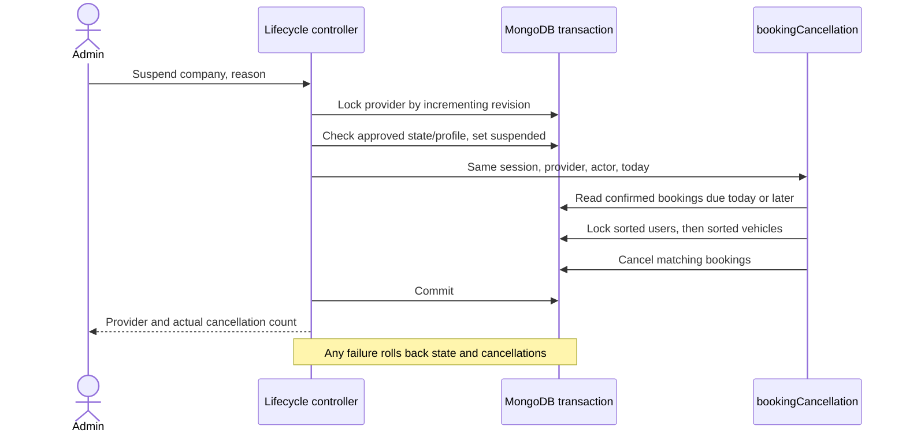

# A03 provider lifecycle

Admin suspension and reactivation implement FR-14. See the [contract](../contracts/openapi.json) for request and response fields.

## Use cases

- An admin suspends an approved company with a reason. All its upcoming/ongoing confirmed bookings are cancelled together with the suspension.
- A suspended representative is denied protected reads and fresh login. An existing session can still log out.
- An admin reactivates a suspended company with an approved profile and a resolution note. Cancelled bookings and revoked sessions remain unchanged.

## Integration contract

`services/bookingCancellation.js` implements the agreed B-owned helper interface. It uses real `bookings` and `vehicles` collections and User guards; it requires the caller's active transaction and provider guard. Saint implemented this dependency to unblock A03 while B's models/API are absent. B owns its subsequent integration and review.

Booking writers must use provider → sorted users → sorted vehicles guards and recheck eligibility inside the same transaction. The integration test uses synthetic native collection fixtures and a competing B-style guarded transaction. It verifies persisted cancellation, rollback after cancellation writes, old-session denial/logout, no restoration and serialization with that competing transaction. It does not verify unimplemented B HTTP endpoints or establish T35 for those endpoints.
