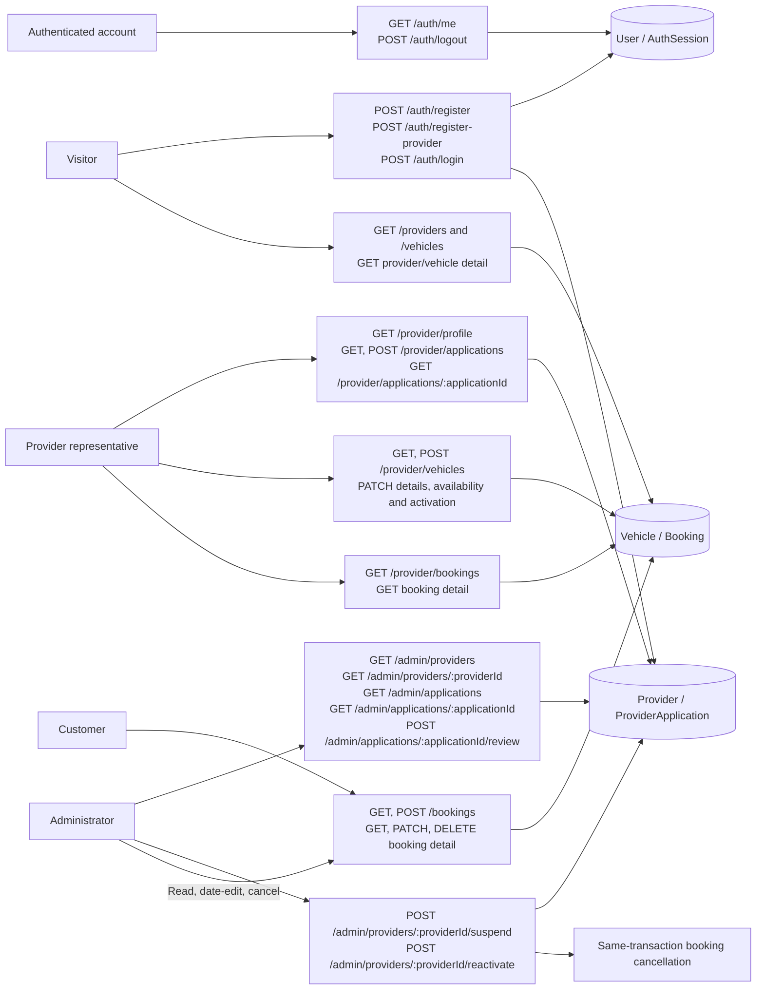
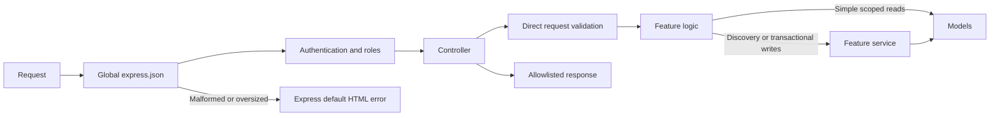

# API map

The [OpenAPI JSON](../contracts/openapi.json) is the authoritative field/status contract. These are the implemented operations, grouped by access. Route paths share `/api/v1`.

## Request flow

Booking list/detail and provider vehicle reads live in controllers. Booking creation/date edits and the separate cancellation flow remain in services with provider → user → vehicle transaction guards. JSON parsing uses the Express default 100 KB limit and runs before route authentication (D-46). Parser failures use Express defaults: malformed JSON returns 400, oversized JSON returns 413, with HTML error bodies (D-49).

Provider protected reads/writes require a current non-suspended provider. Pending/rejected providers can read history and submit revisions but cannot manage vehicles. Logout permits a suspended account. B owns vehicle/booking operations; pending and rejected providers cannot use them.

This is an engineering API map. The instructor's UML Profile for API notation remains unconfirmed under D-07.
