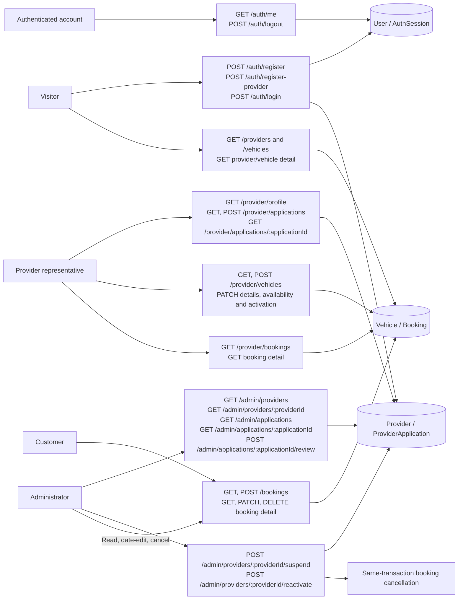
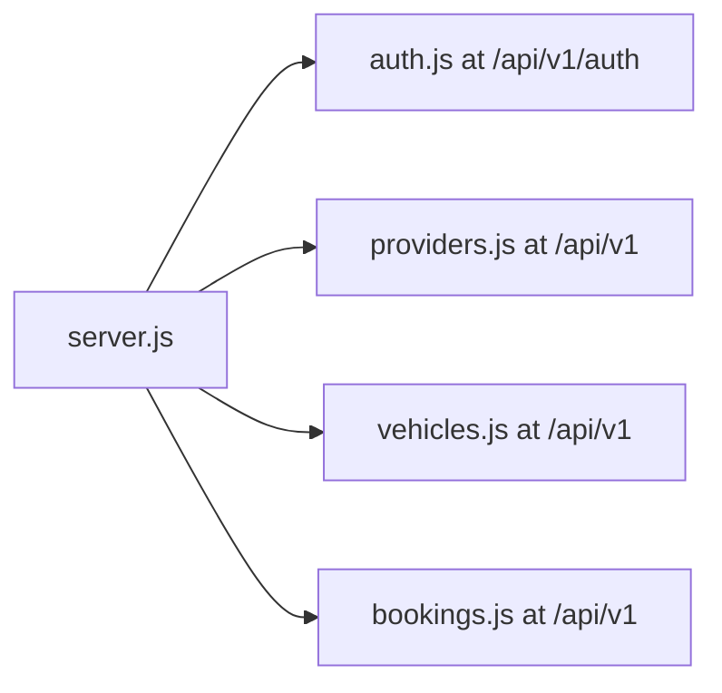
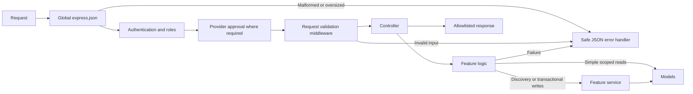

# API map

The [OpenAPI JSON](../contracts/openapi.json) is the authoritative field/status contract. These are the implemented operations, grouped by access. Route paths share `/api/v1`.

## Route files

Each file groups methods by path with router.route() chains. Authentication and roles attach only to protected route chains; public discovery remains accessible when the resource routers share a mount prefix (D-53).

## Request flow

Booking list/detail and provider vehicle reads live in controllers. Booking creation/date edits and the separate cancellation flow remain in services with provider → user → vehicle transaction guards. JSON parsing uses the Express default 100 KB limit and runs before route authentication (D-46). The shared JSON error handler returns 400 for malformed JSON, 413 for oversized bodies and a safe generic 500 for unexpected failures (D-54).

Provider protected reads/writes require a current non-suspended provider. Pending/rejected providers can read history and submit revisions but cannot manage vehicles. Logout permits a suspended account. B owns vehicle/booking operations; pending and rejected providers cannot use them.

This is an engineering API map. The instructor's UML Profile for API notation remains unconfirmed under D-07.
