# Sequence diagrams

These feature views follow the Chapter 6 slide 33 request-flow example and the current source: client → server → router/middleware → controller → service when used → models/collections → MongoDB. Grouped model lifelines keep the diagrams readable; their labels name the actual dependencies. Self-messages represent local rules and serialization.

Transaction boundaries stay in their owning controller or service. Operations within a transaction use the same session sequentially. The diagrams summarize source behavior; they are not substitutes for runtime race tests or an exact trace of Mongoose internals. Unless a branch explicitly stops, a successful response follows only after the shown work succeeds. Exceptions propagate through `next(error)` to the shared JSON handler.

[REST operations](api-diagram.md) provide full URLs, payloads and statuses; [use cases](use-case-diagrams.md) provide actor goals. Common private reads are consolidated into one sequence rather than repeated for every list/detail route.

## Views

- [Register customer or provider](#register-customer-or-provider)
- [Log in](#log-in)
- [Protected requests and logout](#protected-requests-and-logout)
- [Submit a profile revision](#submit-a-profile-revision)
- [Approve or reject an application](#approve-or-reject-an-application)
- [Browse providers and search vehicles](#browse-providers-and-search-vehicles)
- [Create or update an owned vehicle](#create-or-update-an-owned-vehicle)
- [Create or date-edit a booking](#create-or-date-edit-a-booking)
- [Read private records and booking history](#read-private-records-and-booking-history)
- [Cancel a booking](#cancel-a-booking)
- [Suspend provider and cancel rentals atomically](#suspend-provider-and-cancel-rentals-atomically)
- [Reactivate a provider](#reactivate-a-provider)

## Register customer or provider

FR-01, FR-02, FR-10. Both public registration handlers own the transaction; provider registration also creates the business and application version 1.

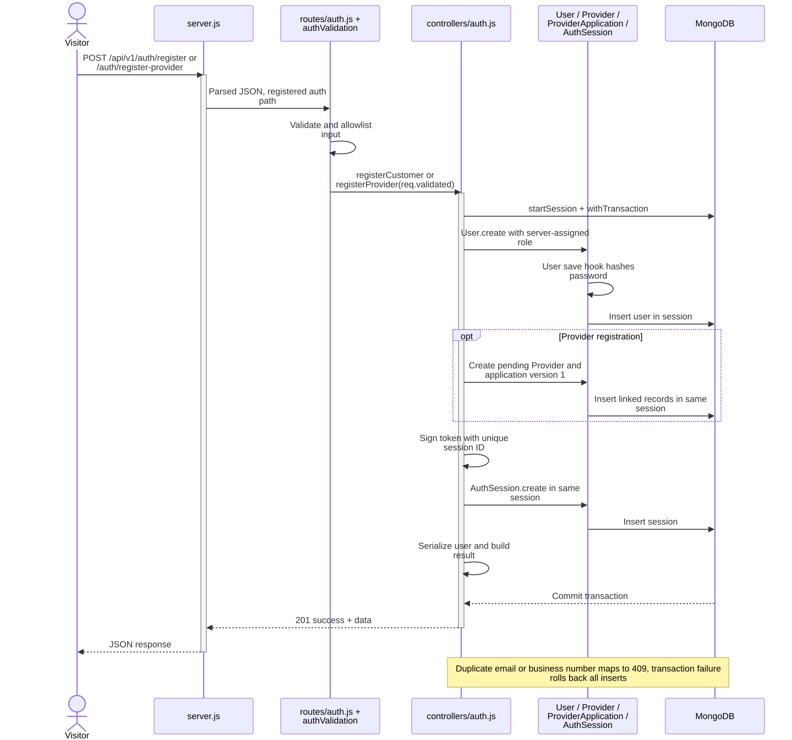

[Mermaid source](diagrams/sequence-registration.mmd) · [Full-size SVG](diagrams/sequence-registration.svg)

Implementation: [routes/auth.js](../routes/auth.js), [controllers/auth.js](../controllers/auth.js), [models/User.js](../models/User.js).

## Log in

FR-02; NFR-01. Login creates a separate revocable session. A provider’s current suspension status is checked before issuing it.

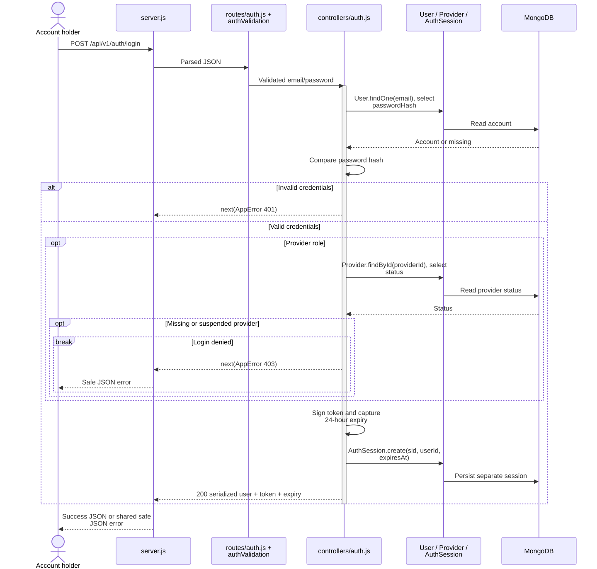

[Mermaid source](diagrams/sequence-login.mmd) · [Full-size SVG](diagrams/sequence-login.svg)

Implementation: [routes/auth.js](../routes/auth.js), [controllers/auth.js](../controllers/auth.js), [middleware/errorHandler.js](../middleware/errorHandler.js).

## Protected requests and logout

FR-02; NFR-02. Authentication precedes roles/approval/route validation. Public health skips authentication. Global JSON parsing happens first.

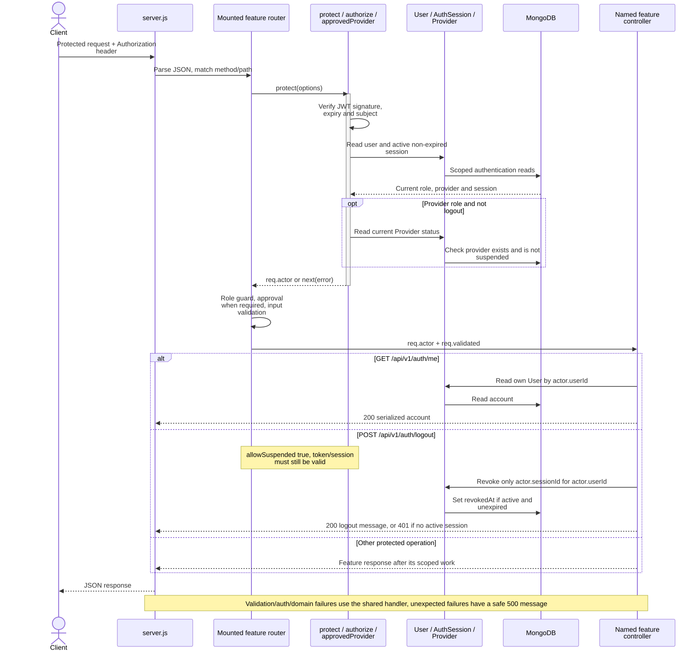

[Mermaid source](diagrams/sequence-session-access.mmd) · [Full-size SVG](diagrams/sequence-session-access.svg)

Implementation: [server.js](../server.js), [middleware/auth.js](../middleware/auth.js), [middleware/approvedProvider.js](../middleware/approvedProvider.js), [controllers/auth.js](../controllers/auth.js).

## Submit a profile revision

FR-10, FR-11. The existing approved profile remains public while the new immutable version is pending.

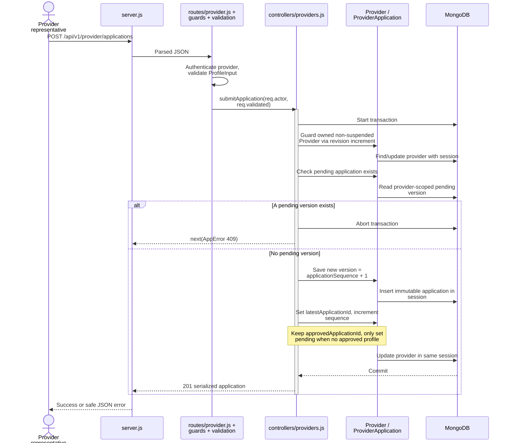

[Mermaid source](diagrams/sequence-application-submit.mmd) · [Full-size SVG](diagrams/sequence-application-submit.svg)

Implementation: [routes/provider.js](../routes/provider.js), [controllers/providers.js](../controllers/providers.js), [models/ProviderApplication.js](../models/ProviderApplication.js).

## Approve or reject an application

FR-11. The lifecycle state is independent of profile approval: approving a revision cannot unsuspend a provider.

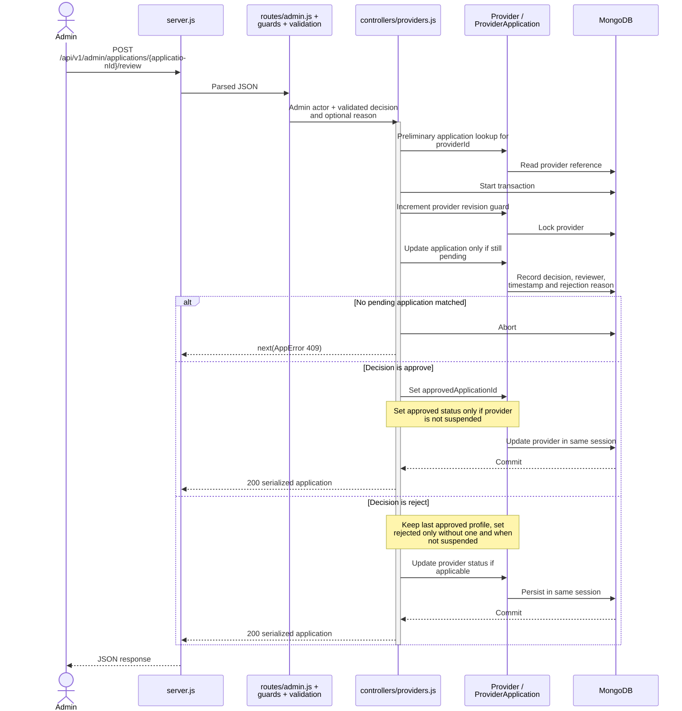

[Mermaid source](diagrams/sequence-application-review.mmd) · [Full-size SVG](diagrams/sequence-application-review.svg)

Implementation: [routes/admin.js](../routes/admin.js), [controllers/providers.js](../controllers/providers.js).

## Browse providers and search vehicles

FR-03, FR-12. Discovery is public and does not reserve capacity. Services run aggregation pipelines; date availability is checked only when both dates are supplied.

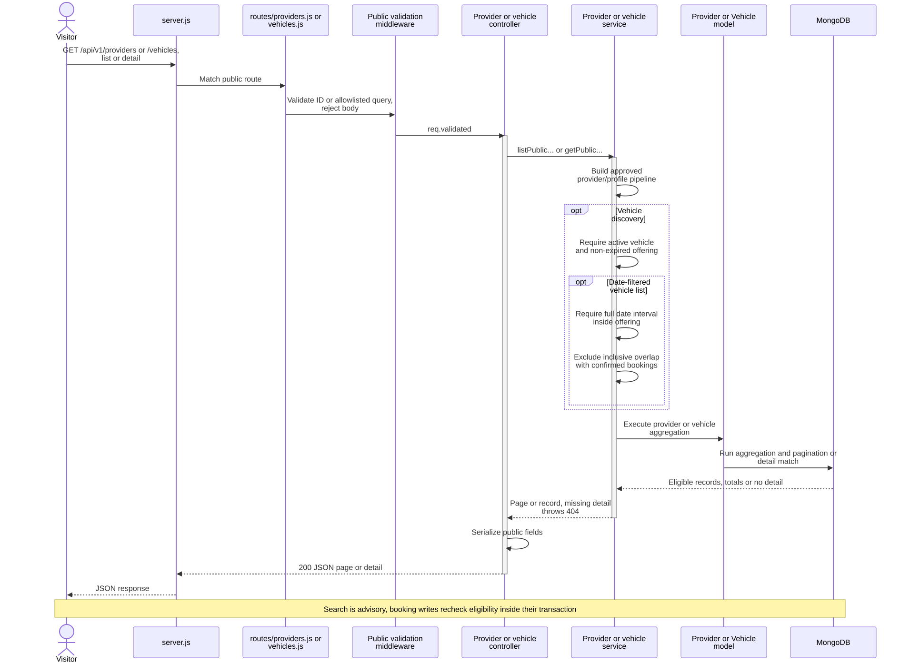

[Mermaid source](diagrams/sequence-discovery.mmd) · [Full-size SVG](diagrams/sequence-discovery.svg)

Implementation: [routes/providers.js](../routes/providers.js), [routes/vehicles.js](../routes/vehicles.js), [controllers/providers.js](../controllers/providers.js), [controllers/vehicles.js](../controllers/vehicles.js), [services/providers.js](../services/providers.js), [services/vehicles.js](../services/vehicles.js).

## Create or update an owned vehicle

FR-12. The service owns the transaction and repeats provider approval inside it. Existing booking snapshots are never rewritten.

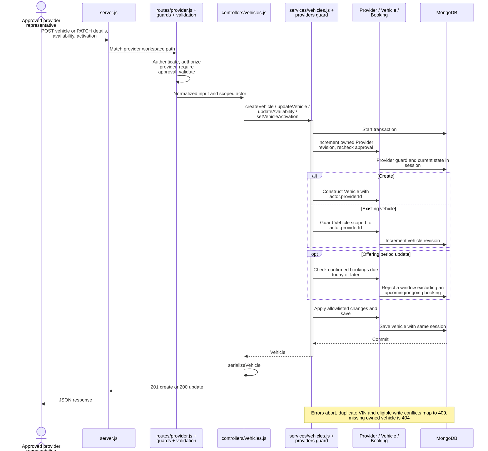

[Mermaid source](diagrams/sequence-vehicle-write.mmd) · [Full-size SVG](diagrams/sequence-vehicle-write.svg)

Implementation: [routes/provider.js](../routes/provider.js), [controllers/vehicles.js](../controllers/vehicles.js), [services/vehicles.js](../services/vehicles.js), [services/providers.js](../services/providers.js).

## Create or date-edit a booking

FR-03, FR-05, FR-08. Provider → user → vehicle guards serialize overlapping writers and enforce the customer cap across providers. All transaction operations use one session.

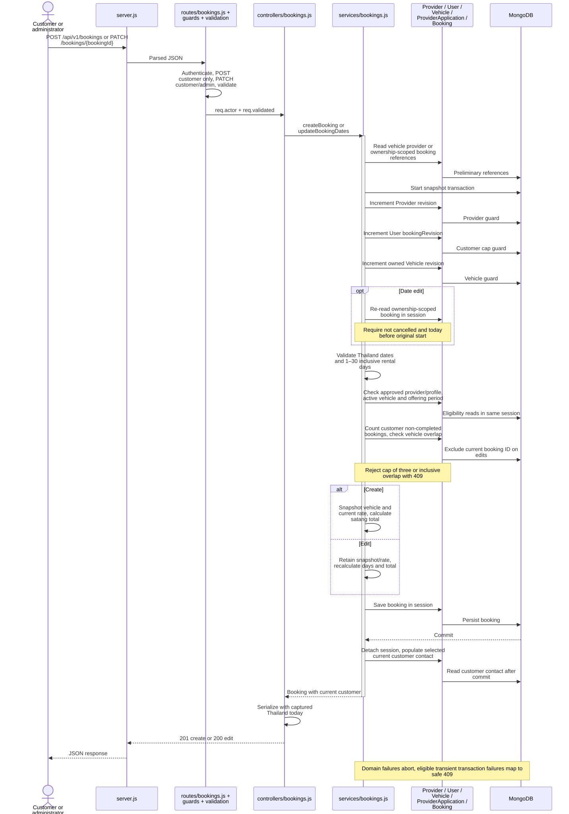

[Mermaid source](diagrams/sequence-booking-write.mmd) · [Full-size SVG](diagrams/sequence-booking-write.svg)

Implementation: [routes/bookings.js](../routes/bookings.js), [controllers/bookings.js](../controllers/bookings.js), [services/bookings.js](../services/bookings.js), [serializers/bookings.js](../serializers/bookings.js).

## Read private records and booking history

FR-04, FR-07, FR-10, FR-11, FR-13. This shared read pattern covers representative profile/application/vehicle/booking reads, administrator provider/application reads and customer/admin booking reads. These handlers query models directly.

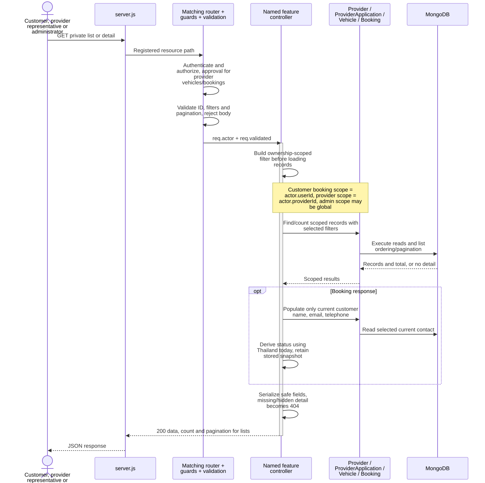

[Mermaid source](diagrams/sequence-scoped-reads.mmd) · [Full-size SVG](diagrams/sequence-scoped-reads.svg)

Implementation: [controllers/providers.js](../controllers/providers.js), [controllers/vehicles.js](../controllers/vehicles.js), [controllers/bookings.js](../controllers/bookings.js).

## Cancel a booking

FR-06, FR-09. DELETE retains the booking record and is idempotent for an already-cancelled, authorized booking. Administrator cancellation may include an ongoing rental.

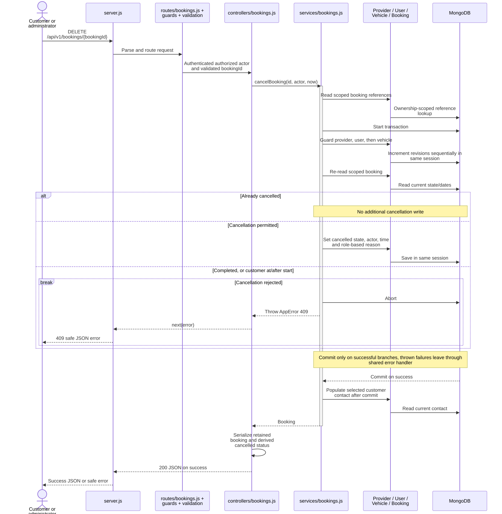

[Mermaid source](diagrams/sequence-booking-cancel.mmd) · [Full-size SVG](diagrams/sequence-booking-cancel.svg)

Implementation: [routes/bookings.js](../routes/bookings.js), [controllers/bookings.js](../controllers/bookings.js), [services/bookings.js](../services/bookings.js).

## Suspend provider and cancel rentals atomically

FR-14. The lifecycle controller owns the transaction; the booking service requires that active caller session. No nested cancellation transaction is created.

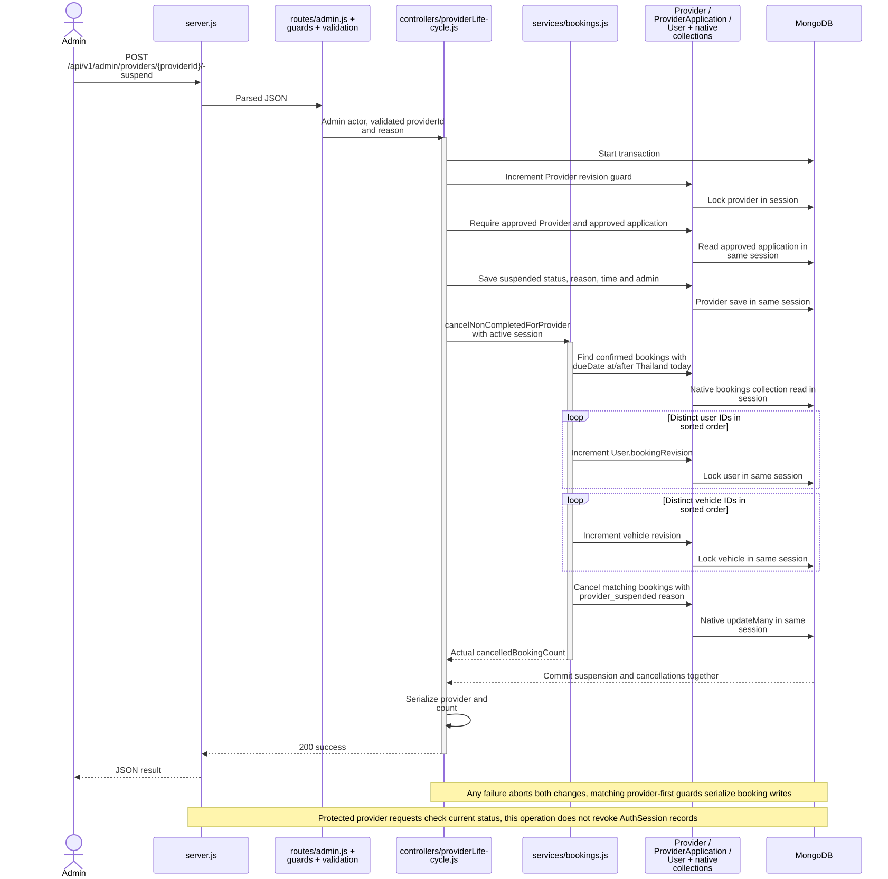

[Mermaid source](diagrams/sequence-provider-suspend.mmd) · [Full-size SVG](diagrams/sequence-provider-suspend.svg)

Implementation: [routes/admin.js](../routes/admin.js), [controllers/providerLifecycle.js](../controllers/providerLifecycle.js), [services/bookings.js](../services/bookings.js), [middleware/auth.js](../middleware/auth.js).

## Reactivate a provider

FR-14. Reactivation changes eligibility only. It does not reactivate vehicles individually, restore bookings or modify session records.

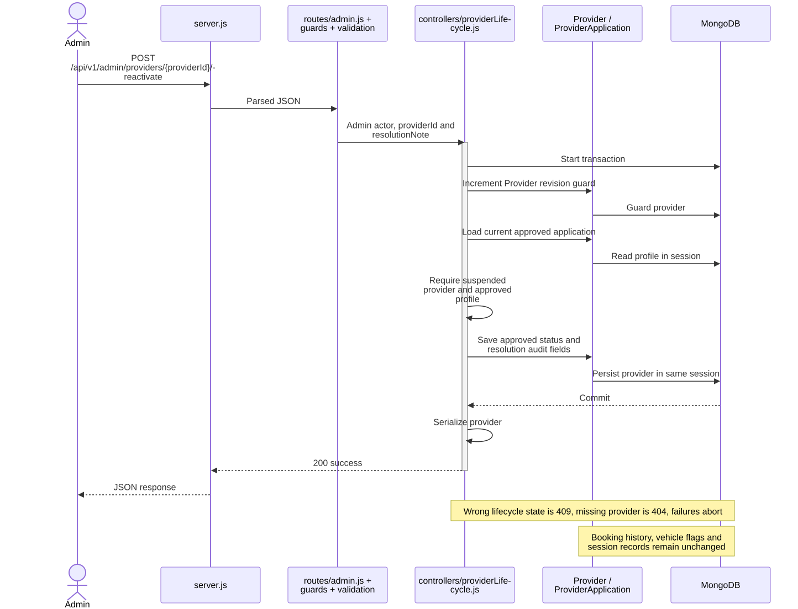

[Mermaid source](diagrams/sequence-provider-reactivate.mmd) · [Full-size SVG](diagrams/sequence-provider-reactivate.svg)

Implementation: [routes/admin.js](../routes/admin.js), [controllers/providerLifecycle.js](../controllers/providerLifecycle.js).

## Editing and exports

Edit the matching `.mmd`, regenerate its `.svg`, and keep both together. Shared [Mermaid settings](diagrams/mermaid-config.json) use the default theme, Arial and native SVG text on white. Each SVG renders directly without Mermaid support. Keep `xml:space="preserve"` on the SVG root.

Rendered with Mermaid 11.17.2 through Mermaid CLI 11.12.0. Renderer tooling is separate from application dependencies. Example export command:

```sh
mmdc -i docs/diagrams/sequence-registration.mmd \
  -o docs/diagrams/sequence-registration.svg \
  -c docs/diagrams/mermaid-config.json -b white
```
