# Use case diagrams

These views describe actor goals for the implemented rental API, split into accounts/discovery, bookings, provider operations and provider administration. Mermaid has no native UML use-case syntax, so flowcharts use `«actor»` boxes, oval use cases, a system boundary, undirected actor associations and directed `«include»` dependencies. Actor state qualifiers do not add account roles. Authentication is a precondition rather than a separate included goal on every protected use case.

See [requirements](requirements.md), [textual use cases](use-cases.md), [REST profile](api-diagram.md) and [request sequences](sequence-diagrams.md).

## Views

- [Accounts and discovery](#accounts-and-discovery)
- [Customer and administrator bookings](#customer-and-administrator-bookings)
- [Provider operations](#provider-operations)
- [Provider administration](#provider-administration)

## Accounts and discovery

FR-01–FR-03, FR-10; NFR-01. Visitor means any public API caller. Account holder means any authenticated role; these are access contexts, not additional stored roles. Suspended representatives may log out, but cannot log in or read protected data.



[Mermaid source](diagrams/use-case-accounts.mmd) · [Full-size SVG](diagrams/use-case-accounts.svg)

Implementation: [docs/requirements.md](../docs/requirements.md), [docs/use-cases.md](../docs/use-cases.md).

## Customer and administrator bookings

FR-03–FR-09. Only customers create bookings. Customers see their own records; administrators have global scope. Date edits retain the booked rate and snapshot. Cancellation retains history; completed bookings cannot be cancelled.



[Mermaid source](diagrams/use-case-rentals.mmd) · [Full-size SVG](diagrams/use-case-rentals.svg)

Implementation: [docs/requirements.md](../docs/requirements.md), [docs/use-cases.md](../docs/use-cases.md).

## Provider operations

FR-10–FR-14. Approval is required for vehicle management and booking reads; non-suspended pending/rejected representatives may use profile/history and submit. Suspension and bulk cancellation are atomic. Reactivation does not restore cancelled bookings.



[Mermaid source](diagrams/use-case-providers.mmd) · [Full-size SVG](diagrams/use-case-providers.svg)

Implementation: [docs/requirements.md](../docs/requirements.md), [docs/use-cases.md](../docs/use-cases.md).

## Provider administration

FR-11, FR-14. Administrators review applications and manage provider lifecycle. Suspension includes bulk cancellation in one transaction. Reactivation does not restore cancelled bookings, and application approval never clears suspension.



[Mermaid source](diagrams/use-case-provider-administration.mmd) · [Full-size SVG](diagrams/use-case-provider-administration.svg)

Implementation: [requirements](requirements.md), [administrator routes](../routes/admin.js), [provider lifecycle controller](../controllers/providerLifecycle.js).

## Editing and exports

Edit the matching `.mmd`, regenerate its `.svg`, and keep both together. Shared [Mermaid settings](diagrams/mermaid-config.json) use the default theme, Arial and native SVG text on white. Each SVG renders directly without Mermaid support. Keep `xml:space="preserve"` on the SVG root.

Rendered with Mermaid 11.17.2 through Mermaid CLI 11.12.0. Renderer tooling is separate from application dependencies. Example export command:

```sh
mmdc -i docs/diagrams/use-case-accounts.mmd \
  -o docs/diagrams/use-case-accounts.svg \
  -c docs/diagrams/mermaid-config.json -b white
```
